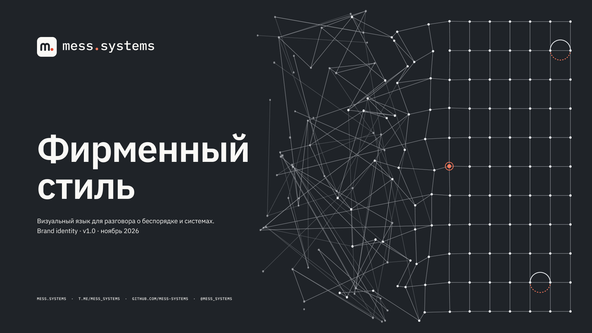
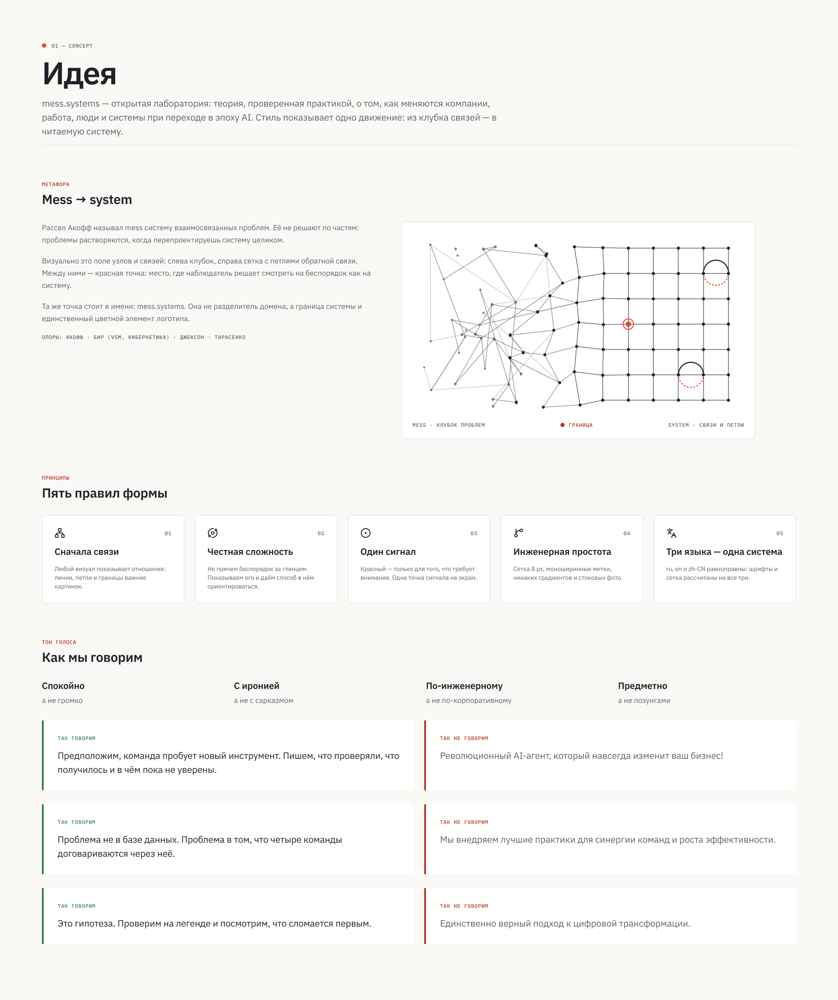
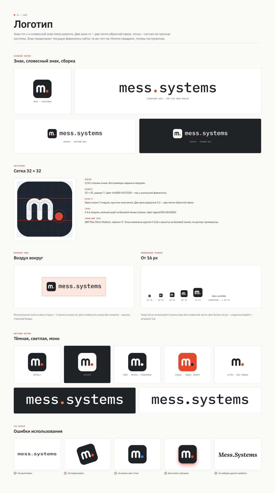
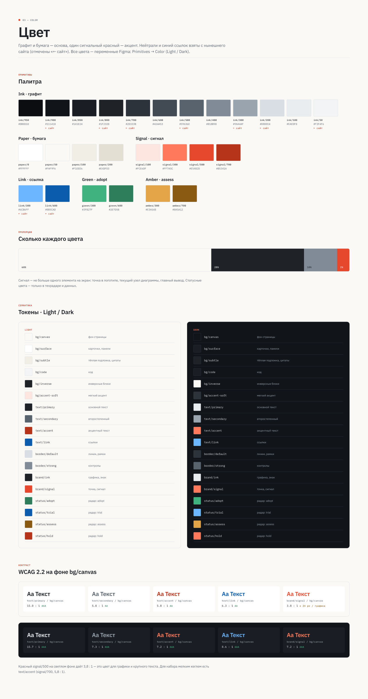
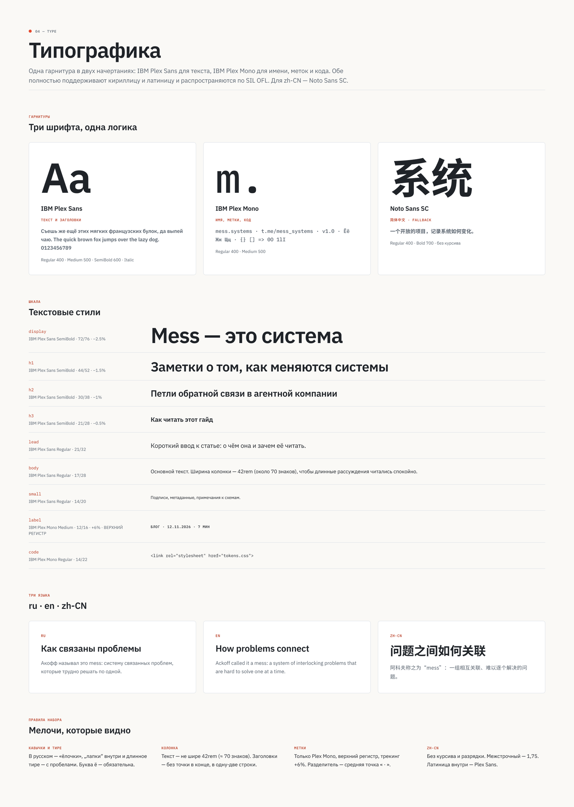

[Русский](README.md) | **English** | [简体中文](README.zh-CN.md)

# mess.systems brand identity

The visual language of **mess.systems**: the mark, the wordmark, colours, type, graphics, and the rules for using them. This repository holds ready-to-use logo files, site icons and design tokens for CSS and other tools.

Guide pages as images: [`docs/preview/`](docs/preview/).



## Idea

Russell Ackoff called a system of interconnected problems a *mess*. Fix them one at a time and they come back in another shape. Ackoff's answer was not to solve such problems separately, but to redesign the system so that they dissolve.

The style shows this one movement: from a tangle of links to a readable system with feedback loops. That is where the node-and-link pattern, the diagrams in the spirit of Stafford Beer's Viable System Model, and the dot in the name come from. The dot in `mess.systems` sits on the boundary: mess on the left, systems on the right. It is the only coloured element of the logo.

Five rules of form:

1. **Links first.** Lines, loops and boundaries matter more than pictures.
2. **Honest complexity.** We don't hide the mess; we give a way to find your bearings in it.
3. **One signal.** Red only for what needs attention. One signal dot per screen.
4. **Engineering plainness.** An 8 px grid, monospaced labels, no gradients, no stock photos.
5. **Three languages, one system.** Russian, English and Chinese are equal.



## Logo

| File | What it is |
|---|---|
| [`logo/mark-default.svg`](logo/mark-default.svg) | The “m.” mark on a dark square, primary version |
| [`logo/mark-inverse.svg`](logo/mark-inverse.svg) | Light square for dark backgrounds |
| [`logo/mark-mono.svg`](logo/mark-mono.svg) | One colour: print, engraving |
| [`logo/mark-signal.svg`](logo/mark-signal.svg) | Red square, a rare accent |
| [`logo/mark-glyph.svg`](logo/mark-glyph.svg) | Without the square |
| [`logo/wordmark-ink.svg`](logo/wordmark-ink.svg), [`-paper`](logo/wordmark-paper.svg), [`-mono`](logo/wordmark-mono.svg) | Wordmark for light backgrounds, dark backgrounds, and one colour |
| [`logo/lockup-light.svg`](logo/lockup-light.svg), [`lockup-dark.svg`](logo/lockup-dark.svg) | Mark and wordmark together |
| [`logo/favicon-16.svg`](logo/favicon-16.svg), [`logo/favicon.ico`](logo/favicon.ico), [`logo/png/`](logo/png/) | Site icons: SVG with a heavier stroke for 16 px, ICO 16/32/48, PNG 16, 32, 180, 512 |



**Construction.** The mark is built on a 32 × 32 grid. A square with radius 7 in `ink/800`. The m is a single stroke 3 units wide with round caps; its two arches of radius 3.1 read as two feedback loops. The dot, 4.6 units across, sits on the baseline in `signal/500`. The wordmark is set in IBM Plex Mono Medium; its dot is replaced by a circle 0.36 of the x-height across.

**Clear space.** At least half the height of the mark on every side. For the wordmark alone, at least the x-height.

**Minimum sizes.** The mark from 16 px; at 16 px use `favicon-16.svg`, which has a heavier stroke. The wordmark from 96 px wide. Below 24 px show the mark only.

**Don't:** stretch or squash, rotate, recolour the dot, add shadows or glows, set the name in another typeface, place the mark on a busy background.

## Colour

Graphite and paper are the base; one signal red is the accent. The neutrals and the link blue come from the current mess.systems site.

**Primitives** (`--ms-*` in [`tokens/tokens.css`](tokens/tokens.css)):

| Family | Steps |
|---|---|
| ink | 950 `#0B0D10` · 900 `#111418` · 850 `#1A1E24` · 800 `#1F2328` · 700 `#2D333B` · 600 `#424A53` · 500 `#59636E` · 400 `#818B98` · 300 `#9AA4AF` · 200 `#D8DEE4` · 100 `#EAEDF0` · 50 `#F3F4F6` |
| paper | 0 `#FFFFFF` · 50 `#FAF9F6` · 100 `#F1EEE6` · 200 `#E4DFD3` |
| signal | 100 `#FCE6DF` · 300 `#FF7A5C` · 500 `#E5482D` · 700 `#B5341A` |
| link | 300 `#6CB6FF` · 600 `#0B5CAD` |
| green | 300 `#3FB27F` · 600 `#2E7D5B` |
| amber | 300 `#E3A548` · 700 `#8A5A12` |

**Semantic tokens** for the light and dark themes:

| Token | Light | Dark | Use |
|---|---|---|---|
| `--bg-canvas` | paper/50 | ink/900 | page background |
| `--bg-surface` | paper/0 | ink/850 | cards, panels |
| `--bg-subtle` | paper/100 | ink/800 | tints, quotes |
| `--bg-code` | ink/50 | ink/850 | code |
| `--bg-inverse` | ink/800 | paper/50 | inverse blocks |
| `--bg-accent-soft` | signal/100 | ink/700 | soft accent |
| `--text-primary` | ink/800 | ink/100 | body text |
| `--text-secondary` | ink/500 | ink/300 | secondary text |
| `--text-inverse` | paper/50 | ink/900 | text on inverse |
| `--text-accent` | signal/700 | signal/300 | accent text |
| `--text-link` | link/600 | link/300 | links |
| `--border-default` | ink/200 | ink/700 | rules, frames |
| `--border-strong` | ink/400 | ink/500 | controls |
| `--brand-ink` | ink/800 | ink/100 | graphics, mark |
| `--brand-signal` | signal/500 | signal/300 | dot, signal |
| `--brand-paper` | paper/50 | ink/900 | graphics background |
| `--status-adopt` · `-trial` · `-assess` · `-hold` | green/600 · link/600 · amber/700 · signal/700 | green/300 · link/300 · amber/300 · signal/300 | tech radar rings |

**Contrast** on `--bg-canvas`, WCAG 2.2: body text 15.0 : 1 (dark theme 15.7 : 1), secondary 5.8 : 1 (7.3 : 1), accent 5.8 : 1 (7.2 : 1), links 6.3 : 1 (8.6 : 1). `signal/500` on light backgrounds is only 3.8 : 1, so it is for graphics and text from 24 px; small text uses `--text-accent`.

**Proportions:** paper about 60 %, graphite about 28 %, neutrals about 10 %, signal about 2 %.



## Type

| Typeface | Role | Weights |
|---|---|---|
| [IBM Plex Sans](https://github.com/IBM/plex) | text and headings | Regular 400, Medium 500, SemiBold 600 |
| [IBM Plex Mono](https://github.com/IBM/plex) | wordmark, labels, code | Regular 400, Medium 500 |
| [Noto Sans SC](https://github.com/notofonts/noto-cjk) | Chinese (zh-CN) | Regular 400, Bold 700 |

All three are under the SIL Open Font License 1.1. They are not included here, only referenced (see [NOTICE.md](NOTICE.md)).

Scale: display 72/76, h1 44/52, h2 30/38, h3 21/28, lead 21/32, body 17/28, small 14/20, label (Plex Mono Medium 12/16, +6 % tracking, uppercase), code (Plex Mono 14/22). Chinese: heading 40/52, text 17/30.

Typesetting: text column no wider than 42rem. Russian uses «guillemets» and spaced em dashes. Chinese: no italics, line height 1.75.



## Graphics

- **The “mess → system” pattern.** A regular grid of nodes; disorder fades from left to right and is gone by 60 % of the width. On the ordered side, one or two feedback loops and a single signal node on the boundary. Don't put the pattern under text; it sits next to it.
- **Diagrams.** System node, signal node, environment. Link 1.5 px, loop 2.5 px with an arrow, signal as a dashed signal-colour line, system boundary and environment as dashed ink/400. Labels in Plex Mono 13, lowercase.
- **Icons.** Outline, 24 px, stroke 2. The Figma file uses lucide. Take platform logos (GitHub, X, Telegram) from their owners under their rules; they are not in this repository.
- **Grid.** 8 px step. Site: 12 columns, 24 gutter, 96 margins at 1440.

## Tokens

- [`tokens/tokens.css`](tokens/tokens.css): CSS custom properties. Light by default, dark via `prefers-color-scheme`; `data-theme="light"` or `data-theme="dark"` on `<html>` pins a theme.
- [`tokens/tokens.json`](tokens/tokens.json): the same values in [W3C Design Tokens](https://www.designtokens.org/tr/2025.10/format/) format (DTCG 2025.10), semantics split into `semantic.light` and `semantic.dark`.

```html
<link rel="stylesheet" href="tokens.css">
<style>
  body { background: var(--bg-canvas); color: var(--text-primary); font: var(--type-body); }
  a { color: var(--text-link); }
</style>
```

## Do and don't

Do:

- use the mark or lockup to refer to the mess.systems project or its materials;
- reuse the tokens, scale and rules in your own projects with attribution (CC BY 4.0);
- reuse the pattern as a technique, with your own drawing and without our mark.

Don't:

- use the mark or the name in a way that suggests the project endorses or certifies you, or that you speak for it;
- change the proportions or colours of the logo, or add effects to it;
- use more than one signal element per screen;
- pick “similar” hex values instead of tokens.

## Licences

- Guide text, tokens and code samples: [CC BY 4.0](LICENSE). Attribution: “mess.systems, Pavel Evdokimov”.
- The mark, the wordmark and the name “mess.systems” are not covered by CC BY; see [TRADEMARK.md](TRADEMARK.md).
- Fonts and third-party material: [NOTICE.md](NOTICE.md).
