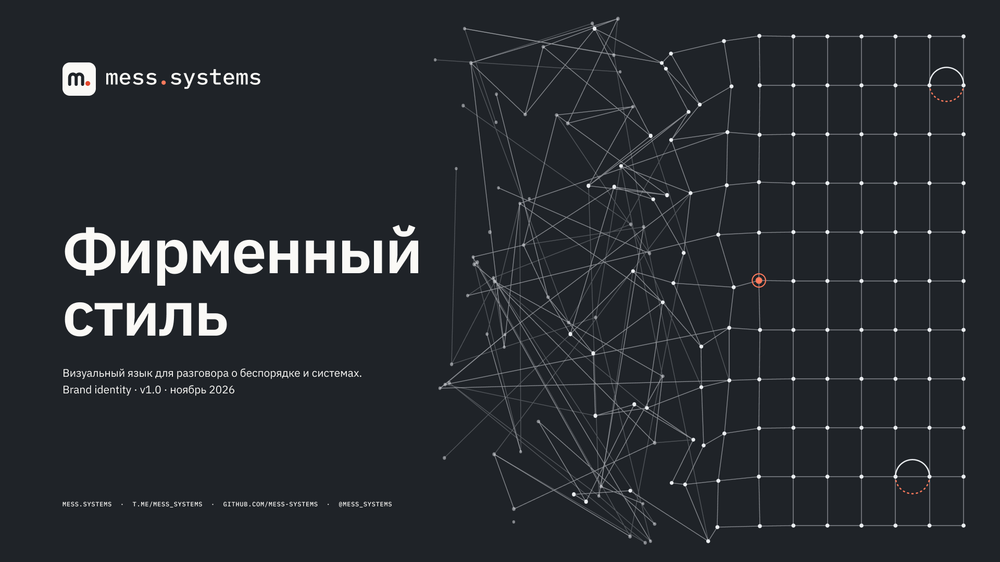
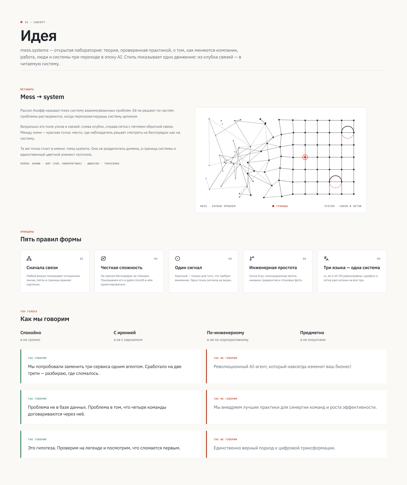
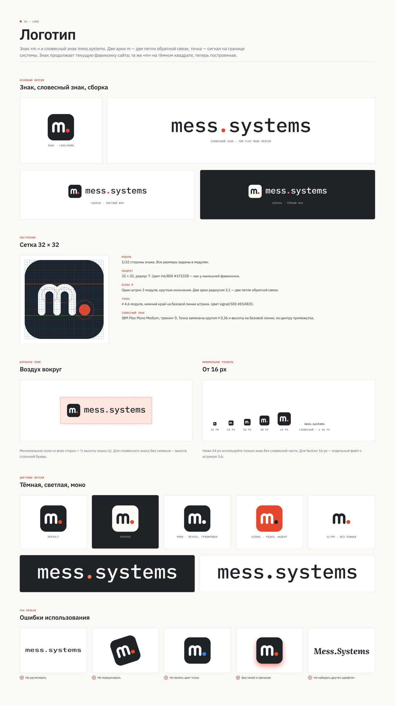
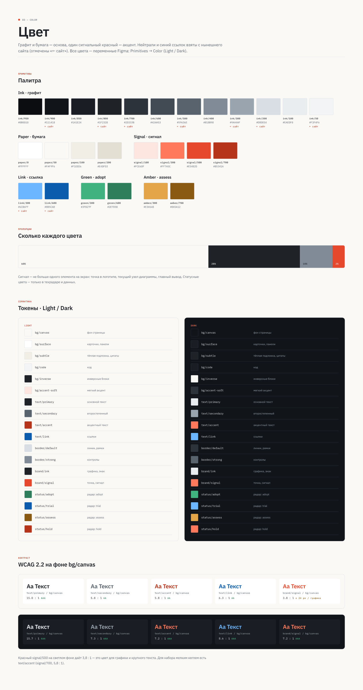
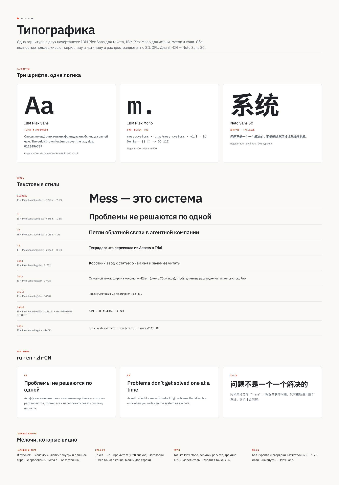

**Русский** | [English](README.en.md) | [简体中文](README.zh-CN.md)

# Фирменный стиль mess.systems

Визуальный язык проекта **mess.systems**: знак, словесный знак, цвета, шрифты, графика и правила, как всем этим пользоваться. Здесь лежат готовые файлы логотипа, иконки сайта и токены дизайна для CSS и других инструментов.

Исходник в Figma: [«mess.systems — фирменный стиль»](https://www.figma.com/design/DhvKFPRm6hQzBldVbap2EU).



## Идея

Рассел Акофф называл *mess* (у Ф. П. Тарасенко «проблемное месиво») систему взаимосвязанных проблем. Если чинить их по одной, они возвращаются в другом виде. Акофф предлагал не решать такие проблемы по отдельности, а перепроектировать систему так, чтобы они растворялись.

Стиль показывает это одно движение: из клубка связей в читаемую систему с петлями обратной связи. Отсюда паттерн узлов и связей, схемы в духе модели жизнеспособной системы Стаффорда Бира и точка в имени. Точка в `mess.systems` стоит на границе: слева беспорядок, справа системы. Это единственный цветной элемент логотипа.

Пять правил формы:

1. **Сначала связи.** Линии, петли и границы важнее картинок.
2. **Честная сложность.** Беспорядок не прячем, а даём способ в нём ориентироваться.
3. **Один сигнал.** Красный только для того, что требует внимания. Одна точка сигнала на экран.
4. **Инженерная простота.** Шаг сетки 8 px, моноширинные метки, без градиентов и стоковых фото.
5. **Три языка, одна система.** Русский, английский и китайский равноправны.



## Логотип

| Файл | Что это |
|---|---|
| [`logo/mark-default.svg`](logo/mark-default.svg) | Знак «m.» на тёмном квадрате, основной вариант |
| [`logo/mark-inverse.svg`](logo/mark-inverse.svg) | Светлый квадрат для тёмного фона |
| [`logo/mark-mono.svg`](logo/mark-mono.svg) | Одноцветный: печать, гравировка |
| [`logo/mark-signal.svg`](logo/mark-signal.svg) | Красный квадрат, редкий акцент |
| [`logo/mark-glyph.svg`](logo/mark-glyph.svg) | Без плашки |
| [`logo/wordmark-ink.svg`](logo/wordmark-ink.svg), [`-paper`](logo/wordmark-paper.svg), [`-mono`](logo/wordmark-mono.svg) | Словесный знак для светлого фона, тёмного фона и в один цвет |
| [`logo/lockup-light.svg`](logo/lockup-light.svg), [`lockup-dark.svg`](logo/lockup-dark.svg) | Знак и словесный знак вместе |
| [`logo/favicon-16.svg`](logo/favicon-16.svg), [`logo/favicon.ico`](logo/favicon.ico), [`logo/png/`](logo/png/) | Иконки сайта: SVG с утолщённым штрихом для 16 px, ICO 16/32/48, PNG 16, 32, 180, 512 |



**Построение.** Знак собран на сетке 32 × 32. Квадрат с радиусом 7, цвет `ink/800`. Буква m нарисована одним штрихом толщиной 3 с круглыми окончаниями. Две арки радиусом 3,1 читаются как две петли обратной связи. Точка диаметром 4,6 стоит на базовой линии, цвет `signal/500`. Словесный знак набран IBM Plex Mono Medium, точка заменена кругом диаметром 0,36 высоты строчной буквы.

**Охранное поле.** Со всех сторон не меньше половины высоты знака. Для словесного знака без символа не меньше высоты строчной буквы.

**Минимальные размеры.** Знак от 16 px. Для 16 px используйте `favicon-16.svg`, в нём штрих толще. Словесный знак от 96 px по ширине. Ниже 24 px показывайте только знак.

**Так нельзя:** растягивать и сжимать, поворачивать, менять цвет точки, добавлять тени и свечение, набирать имя другим шрифтом, класть знак на пёстрый фон.

## Цвет

Графит и бумага служат основой, один сигнальный красный даёт акцент. Нейтрали и синий для ссылок взяты с нынешнего сайта mess.systems.

**Примитивы** (`--ms-*` в [`tokens/tokens.css`](tokens/tokens.css)):

| Семейство | Шаги |
|---|---|
| ink, графит | 950 `#0B0D10` · 900 `#111418` · 850 `#1A1E24` · 800 `#1F2328` · 700 `#2D333B` · 600 `#424A53` · 500 `#59636E` · 400 `#818B98` · 300 `#9AA4AF` · 200 `#D8DEE4` · 100 `#EAEDF0` · 50 `#F3F4F6` |
| paper, бумага | 0 `#FFFFFF` · 50 `#FAF9F6` · 100 `#F1EEE6` · 200 `#E4DFD3` |
| signal, сигнал | 100 `#FCE6DF` · 300 `#FF7A5C` · 500 `#E5482D` · 700 `#B5341A` |
| link, ссылка | 300 `#6CB6FF` · 600 `#0B5CAD` |
| green | 300 `#3FB27F` · 600 `#2E7D5B` |
| amber | 300 `#E3A548` · 700 `#8A5A12` |

**Семантические токены** для светлой и тёмной темы:

| Токен | Светлая | Тёмная | Для чего |
|---|---|---|---|
| `--bg-canvas` | paper/50 | ink/900 | фон страницы |
| `--bg-surface` | paper/0 | ink/850 | карточки, панели |
| `--bg-subtle` | paper/100 | ink/800 | подложки, цитаты |
| `--bg-code` | ink/50 | ink/850 | код |
| `--bg-inverse` | ink/800 | paper/50 | инверсные блоки |
| `--bg-accent-soft` | signal/100 | ink/700 | мягкий акцент |
| `--text-primary` | ink/800 | ink/100 | основной текст |
| `--text-secondary` | ink/500 | ink/300 | второстепенный текст |
| `--text-inverse` | paper/50 | ink/900 | текст на инверсном фоне |
| `--text-accent` | signal/700 | signal/300 | акцентный текст |
| `--text-link` | link/600 | link/300 | ссылки |
| `--border-default` | ink/200 | ink/700 | линии, рамки |
| `--border-strong` | ink/400 | ink/500 | контролы |
| `--brand-ink` | ink/800 | ink/100 | графика, знак |
| `--brand-signal` | signal/500 | signal/300 | точка, сигнал |
| `--brand-paper` | paper/50 | ink/900 | фон графики |
| `--status-adopt` · `-trial` · `-assess` · `-hold` | green/600 · link/600 · amber/700 · signal/700 | green/300 · link/300 · amber/300 · signal/300 | кольца техрадара |

**Контраст** на `--bg-canvas` по WCAG 2.2: основной текст 15,0 : 1 (в тёмной теме 15,7 : 1), второстепенный 5,8 : 1 (7,3 : 1), акцентный 5,8 : 1 (7,2 : 1), ссылки 6,3 : 1 (8,6 : 1). У `signal/500` на светлом фоне только 3,8 : 1, поэтому он идёт на графику и текст от 24 px. Для мелкого текста есть `--text-accent`.

**Пропорции:** бумага около 60 %, графит около 28 %, нейтрали около 10 %, сигнал около 2 %.



## Шрифты

| Шрифт | Роль | Начертания |
|---|---|---|
| [IBM Plex Sans](https://github.com/IBM/plex) | текст и заголовки | Regular 400, Medium 500, SemiBold 600 |
| [IBM Plex Mono](https://github.com/IBM/plex) | словесный знак, метки, код | Regular 400, Medium 500 |
| [Noto Sans SC](https://github.com/notofonts/noto-cjk) | китайский (zh-CN) | Regular 400, Bold 700 |

Все три распространяются по SIL Open Font License 1.1. В репозитории их нет, только ссылки (см. [NOTICE.md](NOTICE.md)).

Шкала: display 72/76, h1 44/52, h2 30/38, h3 21/28, lead 21/32, body 17/28, small 14/20, label (Plex Mono Medium 12/16, разрядка +6 %, верхний регистр), code (Plex Mono 14/22). Для китайского: заголовок 40/52, текст 17/30.

Набор: «ёлочки» снаружи и „лапки“ внутри, длинное тире с пробелами, буква ё. Колонка текста не шире 42rem. В китайском без курсива, межстрочный интервал 1,75.



## Графика

- **Паттерн «mess → system».** Регулярная сетка узлов, хаос убывает слева направо и пропадает к 60 % ширины. На упорядоченной стороне одна-две петли обратной связи и один узел-сигнал на границе. Не кладите паттерн под текст, он стоит рядом.
- **Схемы.** Узел системы, сигнальный узел и среда. Связь 1,5 px, петля 2,5 px со стрелкой, сигнал пунктиром цвета signal, граница системы и среда пунктиром ink/400. Подписи Plex Mono 13 в нижнем регистре.
- **Иконки.** Линейные, 24 px, штрих 2. В Figma использован набор lucide. Логотипы площадок (GitHub, X, Telegram) берите у их владельцев по их правилам, в этом репозитории их нет.
- **Сетка.** Шаг 8 px. Сайт: 12 колонок, гаттер 24, поля 96 на ширине 1440.

## Токены

- [`tokens/tokens.css`](tokens/tokens.css): CSS custom properties. Светлая тема по умолчанию, тёмная по `prefers-color-scheme`. Атрибут `data-theme="light"` или `data-theme="dark"` на `<html>` закрепляет тему.
- [`tokens/tokens.json`](tokens/tokens.json): те же значения в формате [W3C Design Tokens](https://www.designtokens.org/tr/2025.10/format/) (DTCG 2025.10), семантика разделена на группы `semantic.light` и `semantic.dark`.

```html
<link rel="stylesheet" href="tokens.css">
<style>
  body { background: var(--bg-canvas); color: var(--text-primary); font: var(--type-body); }
  a { color: var(--text-link); }
</style>
```

## Можно и нельзя

Можно:

- ставить знак или сборку, чтобы сослаться на проект mess.systems или его материалы;
- брать токены, шкалу и правила для своих проектов с указанием авторства (CC BY 4.0);
- переиспользовать паттерн как приём, если сделан свой рисунок и нет нашего знака.

Нельзя:

- использовать знак и имя так, будто проект вас поддерживает, сертифицирует или вы говорите от его имени;
- менять пропорции и цвета логотипа, добавлять к нему эффекты;
- ставить больше одного сигнального элемента на экран;
- подбирать «похожие» HEX вместо токенов.

## Лицензии

- Тексты гайда, токены и примеры кода: [CC BY 4.0](LICENSE). Указание авторства: «mess.systems, Павел Евдокимов».
- Знак, словесный знак и имя «mess.systems» под CC BY не подпадают, см. [TRADEMARK.md](TRADEMARK.md).
- Шрифты и сторонние материалы: [NOTICE.md](NOTICE.md).
