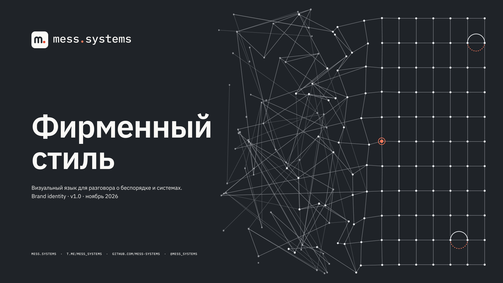
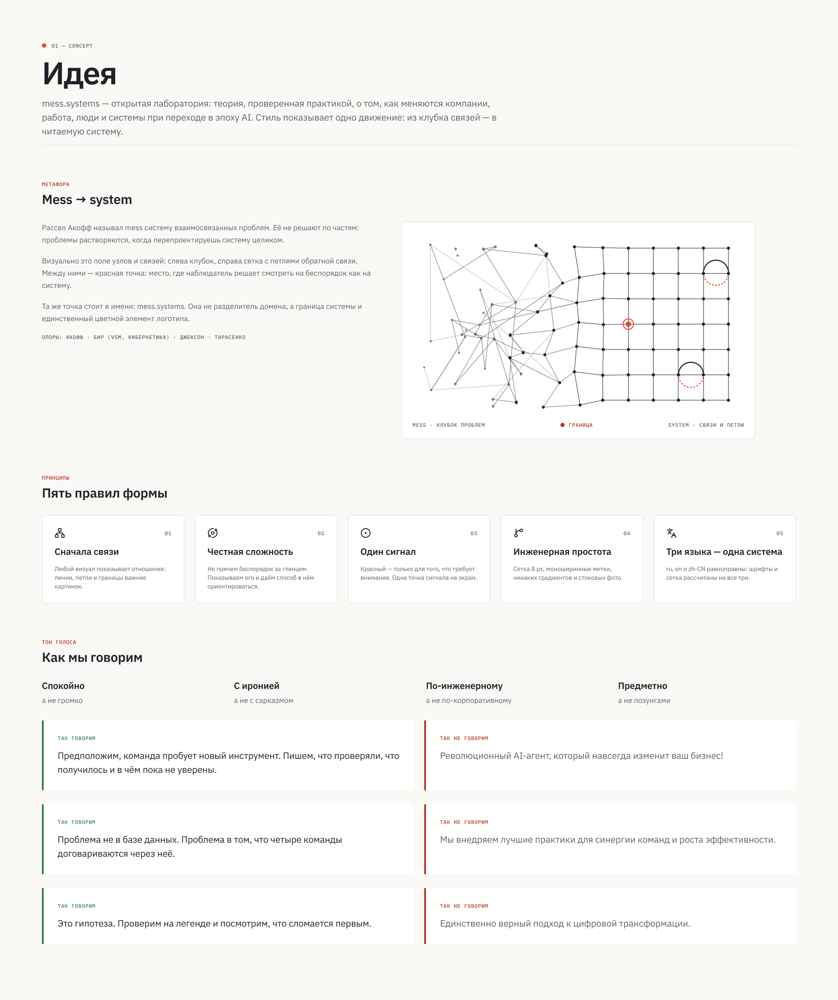
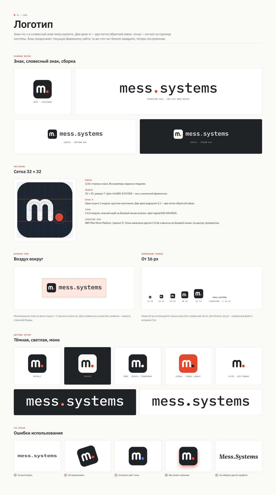
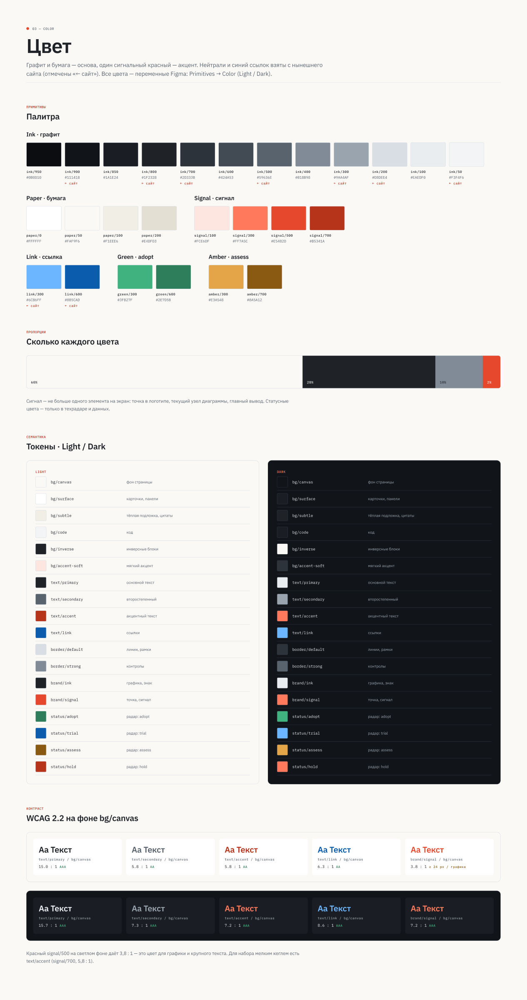
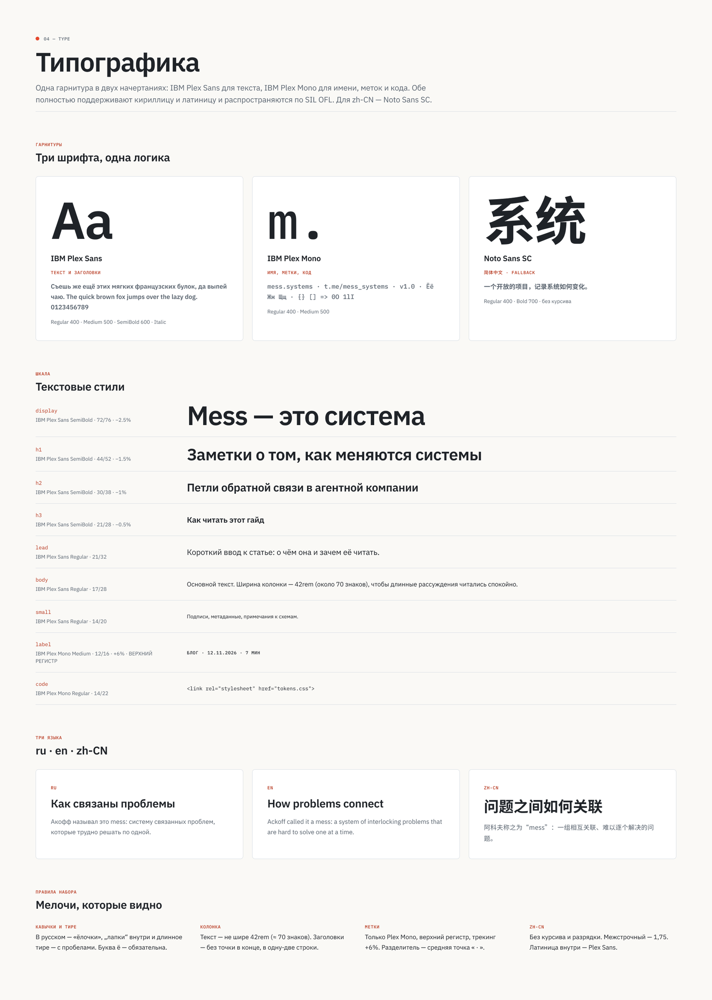

[Русский](README.md) | [English](README.en.md) | **简体中文**

# mess.systems 品牌视觉规范

**mess.systems** 的视觉语言：标志、文字标、颜色、字体、图形，以及使用规则。本仓库提供可直接使用的标志文件、网站图标和设计令牌（CSS 及其他工具）。

规范页面图片：[`docs/preview/`](docs/preview/)。



## 理念

拉塞尔·阿科夫把相互关联的一组问题称为 *mess*。逐个修补，它们会换个样子回来。阿科夫的思路不是分别解决这些问题，而是重新设计系统，让问题自行消解。

这套视觉只表达一个动作：从一团纠缠的联系，走向带有反馈回路、可以读懂的系统。节点与连线的图案、参照斯塔福德·比尔“可行系统模型”的图示，以及名字里的那个点，都由此而来。`mess.systems` 中的点位于边界上：左边是混乱，右边是系统。它是标志中唯一的彩色元素。

五条形式规则：

1. **先看联系。** 线条、回路和边界比图片更重要。
2. **诚实的复杂性。** 不掩盖混乱，而是提供在其中找到方向的办法。
3. **一个信号。** 红色只用于需要注意的东西，每屏只有一个信号点。
4. **工程式的朴素。** 8 px 网格，等宽标签，不用渐变，不用图库照片。
5. **三种语言，一个系统。** 俄语、英语和中文地位平等。



## 标志

| 文件 | 说明 |
|---|---|
| [`logo/mark-default.svg`](logo/mark-default.svg) | 深色方块上的 “m.” 标志，主版本 |
| [`logo/mark-inverse.svg`](logo/mark-inverse.svg) | 浅色方块，用于深色背景 |
| [`logo/mark-mono.svg`](logo/mark-mono.svg) | 单色：印刷、雕刻 |
| [`logo/mark-signal.svg`](logo/mark-signal.svg) | 红色方块，少量点缀 |
| [`logo/mark-glyph.svg`](logo/mark-glyph.svg) | 无底板 |
| [`logo/wordmark-ink.svg`](logo/wordmark-ink.svg)、[`-paper`](logo/wordmark-paper.svg)、[`-mono`](logo/wordmark-mono.svg) | 文字标：浅色背景、深色背景、单色 |
| [`logo/lockup-light.svg`](logo/lockup-light.svg)、[`lockup-dark.svg`](logo/lockup-dark.svg) | 标志与文字标组合 |
| [`logo/favicon-16.svg`](logo/favicon-16.svg)、[`logo/favicon.ico`](logo/favicon.ico)、[`logo/png/`](logo/png/) | 网站图标：16 px 用加粗笔画的 SVG，ICO 16/32/48，PNG 16、32、180、512 |



**构造。** 标志建立在 32 × 32 网格上。圆角半径 7 的方块，颜色 `ink/800`。字母 m 为一笔画成，笔画宽 3，圆头；两个半径 3.1 的拱形代表两条反馈回路。直径 4.6 的点落在基线上，颜色 `signal/500`。文字标使用 IBM Plex Mono Medium，句点替换为直径等于小写字母高度 0.36 倍的圆。

**安全空间。** 四周至少留出标志高度的一半。单独使用文字标时，至少留出一个小写字母的高度。

**最小尺寸。** 标志最小 16 px，16 px 时请使用笔画更粗的 `favicon-16.svg`。文字标宽度不小于 96 px。小于 24 px 时只使用标志。

**禁止：** 拉伸或压扁、旋转、改变点的颜色、添加阴影或发光、用其他字体排名字、把标志放在杂乱的背景上。

## 颜色

石墨色与纸色是基础，唯一的信号红用作强调。中性色和链接蓝沿用当前 mess.systems 网站。

**基础色**（[`tokens/tokens.css`](tokens/tokens.css) 中的 `--ms-*`）：

| 色系 | 色阶 |
|---|---|
| ink 石墨 | 950 `#0B0D10` · 900 `#111418` · 850 `#1A1E24` · 800 `#1F2328` · 700 `#2D333B` · 600 `#424A53` · 500 `#59636E` · 400 `#818B98` · 300 `#9AA4AF` · 200 `#D8DEE4` · 100 `#EAEDF0` · 50 `#F3F4F6` |
| paper 纸 | 0 `#FFFFFF` · 50 `#FAF9F6` · 100 `#F1EEE6` · 200 `#E4DFD3` |
| signal 信号 | 100 `#FCE6DF` · 300 `#FF7A5C` · 500 `#E5482D` · 700 `#B5341A` |
| link 链接 | 300 `#6CB6FF` · 600 `#0B5CAD` |
| green | 300 `#3FB27F` · 600 `#2E7D5B` |
| amber | 300 `#E3A548` · 700 `#8A5A12` |

**语义令牌**（浅色与深色主题）：

| 令牌 | 浅色 | 深色 | 用途 |
|---|---|---|---|
| `--bg-canvas` | paper/50 | ink/900 | 页面背景 |
| `--bg-surface` | paper/0 | ink/850 | 卡片、面板 |
| `--bg-subtle` | paper/100 | ink/800 | 底色、引用 |
| `--bg-code` | ink/50 | ink/850 | 代码 |
| `--bg-inverse` | ink/800 | paper/50 | 反色区块 |
| `--bg-accent-soft` | signal/100 | ink/700 | 柔和强调 |
| `--text-primary` | ink/800 | ink/100 | 正文 |
| `--text-secondary` | ink/500 | ink/300 | 次要文字 |
| `--text-inverse` | paper/50 | ink/900 | 反色背景上的文字 |
| `--text-accent` | signal/700 | signal/300 | 强调文字 |
| `--text-link` | link/600 | link/300 | 链接 |
| `--border-default` | ink/200 | ink/700 | 分隔线、边框 |
| `--border-strong` | ink/400 | ink/500 | 控件 |
| `--brand-ink` | ink/800 | ink/100 | 图形、标志 |
| `--brand-signal` | signal/500 | signal/300 | 点、信号 |
| `--brand-paper` | paper/50 | ink/900 | 图形背景 |
| `--status-adopt` · `-trial` · `-assess` · `-hold` | green/600 · link/600 · amber/700 · signal/700 | green/300 · link/300 · amber/300 · signal/300 | 技术雷达环 |

**对比度**（`--bg-canvas` 上，WCAG 2.2）：正文 15.0 : 1（深色 15.7 : 1），次要文字 5.8 : 1（7.3 : 1），强调文字 5.8 : 1（7.2 : 1），链接 6.3 : 1（8.6 : 1）。`signal/500` 在浅色背景上只有 3.8 : 1，只用于图形和 24 px 以上的文字；小字请用 `--text-accent`。

**比例：** 纸色约 60 %，石墨约 28 %，中性色约 10 %，信号色约 2 %。



## 字体

| 字体 | 用途 | 字重 |
|---|---|---|
| [IBM Plex Sans](https://github.com/IBM/plex) | 正文与标题 | Regular 400、Medium 500、SemiBold 600 |
| [IBM Plex Mono](https://github.com/IBM/plex) | 文字标、标签、代码 | Regular 400、Medium 500 |
| [Noto Sans SC](https://github.com/notofonts/noto-cjk) | 简体中文 | Regular 400、Bold 700 |

三种字体均采用 SIL Open Font License 1.1。本仓库不包含字体文件，只提供链接（见 [NOTICE.md](NOTICE.md)）。

字号：display 72/76，h1 44/52，h2 30/38，h3 21/28，lead 21/32，body 17/28，small 14/20，label（Plex Mono Medium 12/16，字距 +6 %，大写），code（Plex Mono 14/22）。中文：标题 40/52，正文 17/30。

排版：正文栏宽不超过 42rem。中文不使用斜体，行距 1.75，文中的拉丁字母使用 Plex Sans。



## 图形

- **“mess → system” 图案。** 规则的节点网格，混乱从左到右逐渐减弱，到宽度的 60 % 处消失。有序一侧有一两条反馈回路，边界上有一个信号节点。不要把图案放在文字下面，而是放在文字旁边。
- **图示。** 系统节点、信号节点、环境。连线 1.5 px，回路 2.5 px 带箭头，信号用信号色虚线，系统边界和环境用 ink/400 虚线。标签使用 Plex Mono 13，小写。
- **图标。** 线性图标，24 px，笔画 2。Figma 文件使用 lucide。平台标志（GitHub、X、Telegram）请按其所有者的规则从官方获取，本仓库不包含。
- **网格。** 步长 8 px。网站：12 栏，栏间距 24，1440 宽度下页边距 96。

## 令牌

- [`tokens/tokens.css`](tokens/tokens.css)：CSS 自定义属性。默认浅色，深色跟随 `prefers-color-scheme`；在 `<html>` 上设置 `data-theme="light"` 或 `data-theme="dark"` 可固定主题。
- [`tokens/tokens.json`](tokens/tokens.json)：同样的数值，采用 [W3C Design Tokens](https://www.designtokens.org/tr/2025.10/format/) 格式（DTCG 2025.10），语义令牌分为 `semantic.light` 和 `semantic.dark` 两组。

```html
<link rel="stylesheet" href="tokens.css">
<style>
  body { background: var(--bg-canvas); color: var(--text-primary); font: var(--type-body); }
  a { color: var(--text-link); }
</style>
```

## 可以与不可以

可以：

- 使用标志或组合来指代 mess.systems 项目及其材料；
- 在注明出处的前提下（CC BY 4.0），在自己的项目中使用令牌、字号和规则；
- 把图案当作一种手法来借鉴：自己绘制，不带我们的标志。

不可以：

- 以暗示本项目为您背书、认证，或您代表本项目发言的方式使用标志和名称；
- 改变标志的比例和颜色，或给它添加效果；
- 每屏使用超过一个信号元素；
- 用“差不多”的十六进制颜色代替令牌。

## 许可

- 规范文本、令牌和代码示例：[CC BY 4.0](LICENSE)。署名：“mess.systems, Pavel Evdokimov”。
- 标志、文字标和名称 “mess.systems” 不适用 CC BY，见 [TRADEMARK.md](TRADEMARK.md)。
- 字体及第三方材料：[NOTICE.md](NOTICE.md)。
